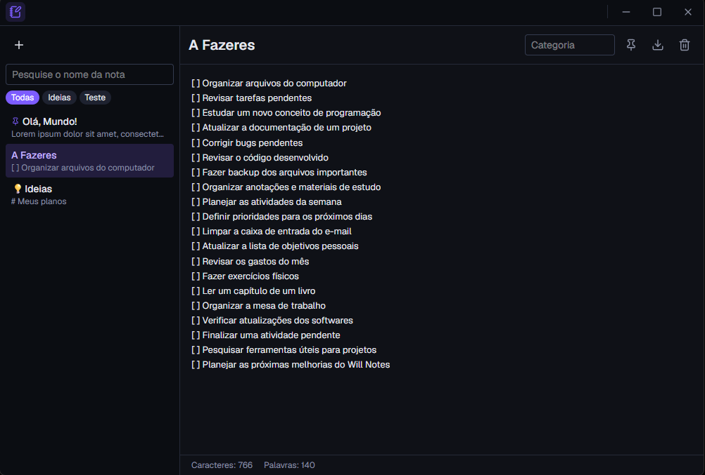

<p align="center">
  
</p>

<h1 align="center">will-notes</h1>

<p align="center">App de notas para desktop feito com Tauri, React e Rust.</p>

<!-- Adicione um print aqui: salve em docs/screenshot.png e descomente a linha abaixo -->
<!--  -->

## Funcionalidades

- Criar, editar e apagar notas, com salvamento automático enquanto você digita
- Busca por título e conteúdo
- Categorias, com filtro na barra lateral
- Fixar notas no topo da lista
- Exportar uma nota como arquivo `.md`
- Contador de palavras e caracteres
- Atalho `Ctrl+N` para criar uma nota
- Tema claro e escuro, seguindo o sistema
- Barra de título própria e tela de carregamento (splash)

## Stack

| Camada | Tecnologia |
|---|---|
| Interface | React 19 + TypeScript |
| Estilo | Tailwind CSS v4 |
| Build do frontend | Vite |
| Backend / desktop | Tauri 2 + Rust |

O React cuida da interface e chama o Rust com `invoke(...)`. O Rust lê e grava as notas em disco.

## Como rodar

Pré-requisitos: [Node.js](https://nodejs.org/), [Rust](https://www.rust-lang.org/tools/install) e os [pré-requisitos do Tauri](https://tauri.app/start/prerequisites/) para o seu sistema.

```bash
npm install
npm run tauri dev
```

Para gerar o instalador:

```bash
npm run tauri build
```

O instalador fica em `src-tauri/target/release/bundle/`.

## Testes

```bash
cd src-tauri
cargo test
```

## Onde ficam as notas

Todas as notas ficam em um único arquivo `notes.json`, na pasta de dados do app:

- Windows: `%APPDATA%\com.wiliammp.will-notes\`
- macOS: `~/Library/Application Support/com.wiliammp.will-notes/`
- Linux: `~/.local/share/com.wiliammp.will-notes/`

## Estrutura

```
src/                      Frontend (React)
  App.tsx                 Tela principal: lista, editor, busca, categorias
  components/             Componentes, como os botões da barra de título
  index.css               Tailwind e cores do tema
  splash.ts               Script da tela de carregamento
src-tauri/                Backend (Rust)
  src/notes.rs            Commands de notas: listar, salvar, apagar, exportar
  src/lib.rs              Registra os plugins e commands
  tauri.conf.json         Janelas, ícones e configuração do app
  capabilities/           Permissões de cada janela
```

## Licença

[MIT](LICENSE)
